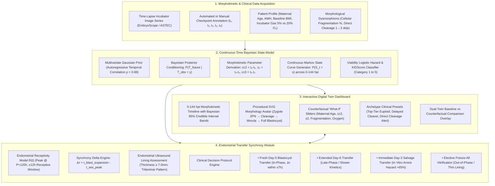

# System Architecture Specification
## Embryo Trajectory Digital Twin (Probabilistic State Model & Endometrial Synchronizer)

### Data Flow & Component Mapping
1. **Inputs:** Incubator time-lapse events and patient clinical history.
2. **State Model Engine (`embryo_model.py` / `probabilisticModel.ts`):** Converts sparse observations into closed-form posterior distributions without requiring external API calls or black-box neural networks.
3. **Reactive UI (`TimelineVisualizer.tsx` / `EmbryoAvatar.tsx` / `WhatIfSliders.tsx`):** Real-time interactive simulation at 60 FPS.
4. **Clinical Synchrony Engine (`TransferSyncModule.tsx`):** Connects the embryo's arrival timing with uterine receptivity to prescribe individualized transfer timing.
